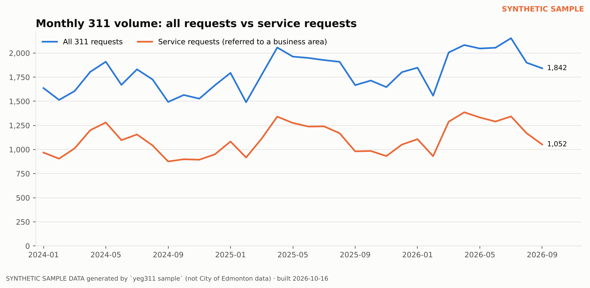
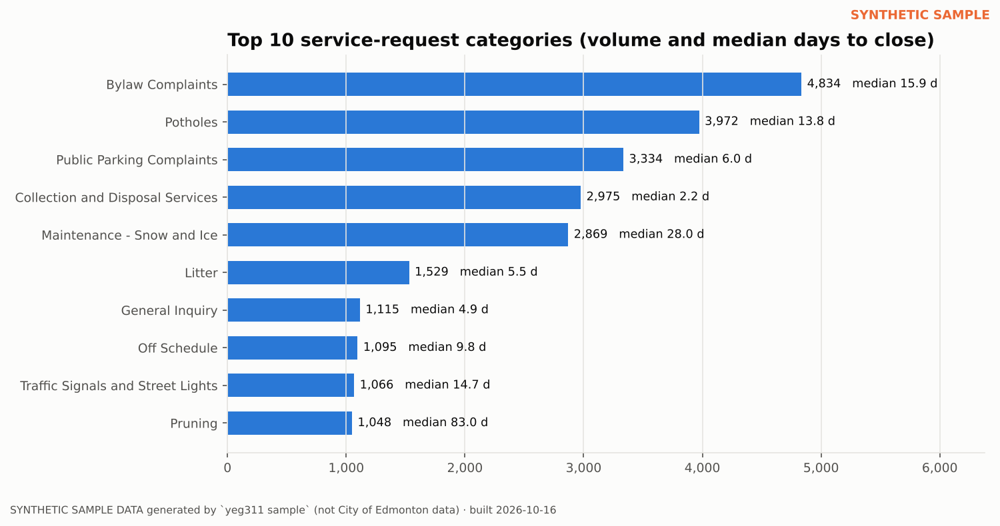
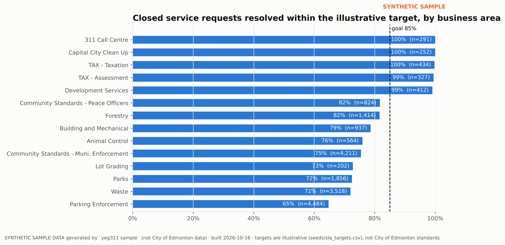
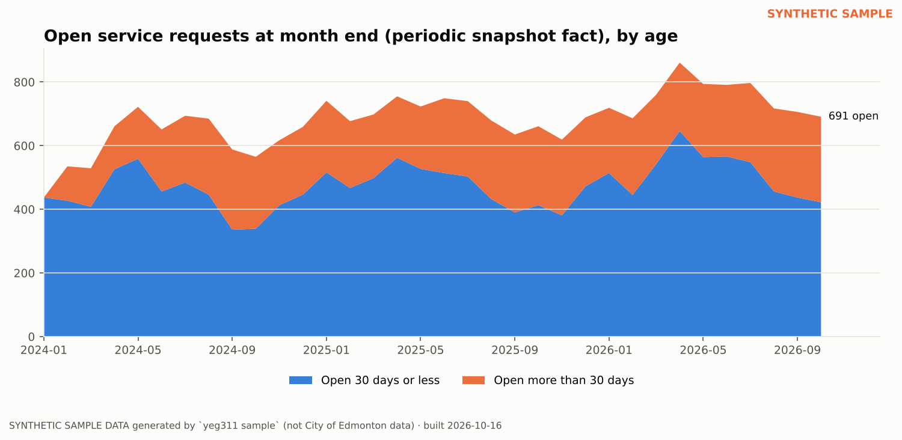
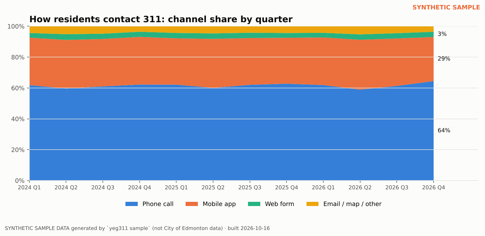
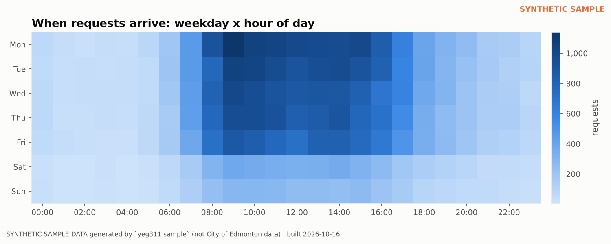
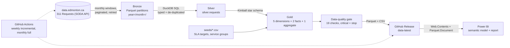
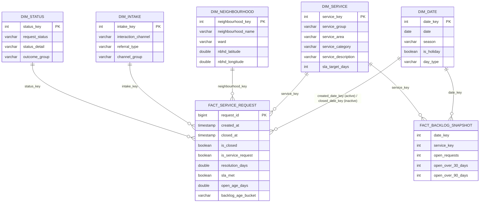

# Edmonton 311 Service Request Analytics

End-to-end analytics platform on the City of Edmonton's live **311 Requests** open dataset (about 3.5 million
service requests over a rolling three-year window): a Python extraction pipeline, a DuckDB star-schema warehouse
with automated data-quality gates, scheduled refreshes through GitHub Actions, and a Power BI semantic model and
report defined as code (Power Query, DAX, TMDL).

[](https://github.com/bl4ck0uc4st/edmonton-311-analytics/actions/workflows/ci.yml)
[](https://github.com/bl4ck0uc4st/edmonton-311-analytics/actions/workflows/refresh-data.yml)


> **Why this exists.** Edmonton employers (City of Edmonton, Government of Alberta, EPCOR, PCL, AHS and most
> consultancies) run their reporting on Power BI and ask for DAX, Power Query, data modelling, SQL and refresh
> automation. This project demonstrates all of it on data the city itself publishes, built the way a production
> BI team would build it: versioned SQL, tests, quality checks, CI, scheduled refresh and a documented semantic model.

## What the dashboard answers

| Page | Question | Highlights |
|---|---|---|
| Executive Overview | What is 311 handling, how fast, and is it improving? | Volume vs prior year, rolling trend, top categories, channel mix, ward map |
| Operations and SLA | Which business areas meet their response targets? | SLA attainment vs goal, resolution-time distribution, backlog ageing |
| Neighbourhoods and Wards | Where do requests come from and what do they ask for? | Neighbourhood bubble map, ward comparison, drill-through detail |
| Seasonality and Channels | When does demand arrive and how do residents contact the City? | Season x service heatmap, weekday x hour intake curve, mobile-app adoption |
| Data Quality and Pipeline | Can this data be trusted today? | 19 automated checks, build metadata, freshness |

## Live previews from the pipeline

The scheduled workflow re-renders these charts from the live dataset every week (`yeg311 charts`) and commits them,
so the repository always shows current numbers. Headline figures: [`docs/latest_stats.md`](docs/latest_stats.md).

| | |
|---|---|
|  |  |
|  |  |
|  |  |

<!-- After building the report in Power BI Desktop, add page screenshots to docs/img and uncomment:
## Power BI report


-->

## Architecture



* **Extract** (`yeg311 extract`): pulls the dataset one calendar month at a time with `$where` windows and
  `$limit/$offset` pagination, exponential-backoff retries and an optional app token. Each month lands in its own
  hive partition, so incremental runs only re-extract a lookback window (requests change status after creation).
* **Transform** (`yeg311 build`, `sql/*.sql`): bronze -> silver -> gold inside a single DuckDB file. Cleaning rules
  include whitespace normalisation, safe casts, status-aware de-duplication and rejection of impossible timestamps.
* **Quality** (`yeg311 quality`): referential integrity, uniqueness, reconciliation between fact, snapshot and
  aggregate tables, freshness and anomaly rates. Critical failures stop the pipeline before anything is published.
* **Export** (`yeg311 export`): the star schema as Parquet/CSV plus `metadata.json`, published to a rolling GitHub
  Release that Power BI refreshes from directly (no gateway needed).

## Data model



Two fact tables with different grains: a **transaction fact** (one row per request) and a **periodic snapshot
fact** (open service requests at the end of every day, by service) so backlog trends do not need an expensive
event-in-progress calculation at query time. Full column documentation: [`docs/data_dictionary.md`](docs/data_dictionary.md).

## Quick start

```bash
git clone https://github.com/bl4ck0uc4st/edmonton-311-analytics.git
cd edmonton-311-analytics
python -m venv .venv && source .venv/bin/activate      # Windows: .venv\Scripts\activate
pip install -e ".[dev]"

# Offline demo on synthetic data (seconds): sample -> warehouse -> quality checks -> exports
yeg311 run --sample --rows 50000

# Real data from data.edmonton.ca (full window is ~3.5M rows; set SOCRATA_APP_TOKEN for a higher rate limit)
yeg311 run --mode full
yeg311 stats
```

Then open Power BI Desktop and follow [`powerbi/README.md`](powerbi/README.md).

| Command | What it does |
|---|---|
| `yeg311 sample --rows N` | Generate realistic synthetic bronze partitions (same shape and quirks as the live data) |
| `yeg311 extract --mode full\|incremental` | Download real data into monthly Parquet partitions (incremental = last 3 months) |
| `yeg311 build` | Build silver and gold layers in `data/warehouse/yeg311.duckdb` |
| `yeg311 quality` | Run the 19 data-quality checks; exit code 1 on a critical failure |
| `yeg311 export` | Write Parquet/CSV exports plus `metadata.json` for Power BI |
| `yeg311 run` | All of the above in order (`--sample` to stay offline) |
| `yeg311 stats` | Headline numbers for the README / a quick sanity check |
| `yeg311 charts --out DIR` | Render six preview charts (PNG, matplotlib) straight from the warehouse |

## Data quality gate

| Check | Severity | What it protects |
|---|---|---|
| `unique_request_id`, `fact_not_empty`, `no_null_created_at` | critical | Grain of the fact table |
| `fk_service`, `fk_neighbourhood`, `fk_intake`, `fk_status`, `fk_created_date`, `fk_closed_date` | critical | Referential integrity of the star schema |
| `no_negative_resolution`, `open_rows_without_close_timestamp` | critical | Timestamp logic after cleaning |
| `backlog_snapshot_reconciles`, `agg_reconciles_to_fact` | critical | The three gold tables agree with each other |
| `closed_before_created_pct`, `closed_without_timestamp_pct`, `unclassified_service_pct`, `missing_neighbourhood_pct` | warning | Anomaly rates stay within expected bands |
| `known_status_values`, `freshness_days` | warning | Source drift and stale data |

Results are stored in `meta.quality_results`, exported for the Power BI "Data Quality" page and surfaced in the
GitHub Actions job summary.

## Automation

* **CI** (`.github/workflows/ci.yml`): ruff lint/format, pytest (24 tests) on Python 3.11 and 3.12, a full pipeline
  smoke run on synthetic data, and a check that the generated Power BI assets match the model spec.
* **Refresh data** (`.github/workflows/refresh-data.yml`): weekly incremental and monthly full extraction from the
  live API, warehouse rebuild, quality gate, then publication of the exports to the `data-latest` release and a
  commit of the refreshed preview charts and headline numbers. Raw partitions are cached between runs so
  incremental mode works in CI.

## Power BI semantic model

Defined as code in [`powerbi/`](powerbi/): Power Query scripts with a `DataSourceMode` parameter (GitHub Release
or local folder), 64 DAX measures in nine display folders (volume, resolution, SLA, backlog, time intelligence,
channels, ranking, data quality, labels), an inactive-relationship pattern for "closed by close date", two
row-level-security roles (static and dynamic `USERPRINCIPALNAME()`), a custom theme and a page-by-page report
specification. The whole model can be applied in one step through the TMDL script.

Generated from a single spec so the M, DAX, TMDL and data dictionary never drift:

```bash
python scripts/build_powerbi_assets.py
```

## Business questions in SQL

`sql/analytics/` answers ten questions directly against the warehouse (monthly trend and closure rate, top request
types with median and P90 resolution, SLA by business area, backlog trend from the snapshot fact, neighbourhood
hotspots with their top category, channel shift to digital, weekday x hour intake profile, holiday effect, backlog
ageing, year-over-year by service group). Run any of them with `duckdb data/warehouse/yeg311.duckdb < sql/analytics/02_top_categories_resolution.sql`.

## Repository layout

```
edmonton-311-analytics/
+-- src/yeg311/              Python package: config, extract, sample, warehouse, quality, export, charts, stats, cli
+-- sql/                     Versioned transformations (bronze -> silver -> gold) and analytics queries
+-- seeds/                   Reference data: service groups, illustrative SLA targets
+-- tests/                   pytest suite (extraction, transformations, quality, export, CLI)
+-- powerbi/                 M queries, DAX measures, TMDL model, theme, RLS sample, report spec
+-- scripts/                 Model spec + generator for the Power BI assets and data dictionary
+-- docs/                    Data dictionary, architecture notes, interview guide
+-- data/                    raw / warehouse / exports (git-ignored; regenerate with `yeg311 run`)
+-- .github/workflows/       CI and scheduled data refresh
```

## Design decisions

* **DuckDB over SQLite/Postgres**: columnar, single-file, reads Parquet natively and chews through 3.5M rows in
  seconds; no server to run on a laptop or a CI runner. Power BI reads the exported Parquet, so no driver is needed.
* **Monthly partitions + lookback window** instead of "new rows since last run": requests change status after they
  are created, so a pure append-only incremental load would freeze every request at its first status.
* **Explicit Unknown members** (`neighbourhood_key = -1`, `Unclassified` services): no fact row is ever dropped by
  an inner join, and the gaps become something you can chart and monitor.
* **Periodic snapshot fact for backlog**: open counts per day are precomputed (with reconciliation checks against
  the transaction fact) so the dashboard's backlog trend is a plain `SUM` rather than a DAX event-in-progress scan.
* **SLA targets are illustrative** and live in a seed file with a precedence rule (category > area > global). They
  are labelled as such in the model; swapping in official service standards is a CSV edit.
* **Model as code**: Power Query, DAX and TMDL are generated from one Python spec so documentation, M and DAX agree.

## Roadmap

* Normalise by population (requests per 1,000 residents) with the City's neighbourhood census dataset.
* Join the 311 Explorer dataset (precise locations for public-property requests) for a point-level map.
* Forecast monthly demand per service group (seasonal model) and show forecast vs actual in Power BI.
* Deploy the semantic model to Power BI Service / Fabric with deployment pipelines.

## Data source and licence

Data: [311 Requests](https://data.edmonton.ca/d/q7ua-agfg), City of Edmonton Open Data Portal, used under the
City of Edmonton Open Data Terms of Use. Locations are anonymised to neighbourhood centroids by the City; this
project never handles personal information. Code is MIT-licensed. Synthetic sample data generated by `yeg311 sample`
is not City data.
